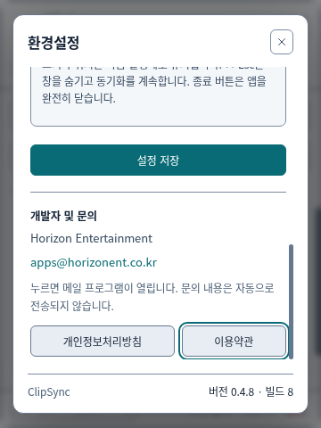

# 0.4.8 · 빌드 8 · 개발자·정책 문서 검증

## 구현

환경설정에 Horizon Entertainment와 apps@horizonent.co.kr을 표시합니다. 문의 버튼은 신뢰한 렌더러의 고정 IPC 작업으로 `mailto:apps@horizonent.co.kr`만 OS 메일 프로그램에 전달합니다. 렌더러가 임의 URL·수신자·첨부물을 지정하지 못하며 이메일을 자동 발송하지 않습니다.

맨 아래 버전·빌드 표시는 설정의 스크롤 영역 바깥에 고정했습니다. 실제 앱 번들 옆 `package.json`에서 버전·빌드번호를 읽으므로 개발용 테스트 진입점·설치된 ASAR에서도 같은 제품 정보를 사용합니다. 0.4.8의 공통 빌드번호는 8이고 Windows 네이티브 파일 버전은 0.4.8.8, Mac CFBundleVersion은 8로 맞춥니다. CI 실행 번호·빌드 날짜로 플랫폼마다 번호가 달라지지 않습니다.

개인정보처리방침과 이용약관은 `legal/`의 UTF-8 원문을 단일 원본으로 사용합니다. Vite는 원문을 앱에 번들하고 배포 빌드는 `dist/legal/`에도 동일 파일을 포함합니다. 앱에서는 HTML 실행 없이 텍스트로 표시하고, 별도 인터넷 접속·외부 페이지를 열지 않습니다. 문서를 닫으면 작성 중인 설정으로 돌아옵니다. 홈페이지에는 같은 TXT 문서를 올리며 소개·목록 페이지를 추가하지 않습니다.

문서 시행일은 2026-10-21·문서 버전 1.0입니다. P2P 연결, 공개 탐색망의 네트워크 메타데이터, 기기 이름 교환, 메모리 기록·암호화한 저장 기록·암호화하지 않는 이미지 캐시, 다운로드 파일·상대 기기 복사본의 삭제 범위, 사용자가 보내는 문의 자료의 처리를 구분했습니다. 앱의 동작을 바꾸거나 새로운 통계·자동 전송을 추가하지 않습니다.

## 실행한 검사 · 2026-10-21 (Asia/Seoul)

- 타입 검사·빌드와 기존 단위·소켓 검사 53개 통과.
- 실제 Electron·Secret Service에서 360×480 창의 환경설정을 위·아래로 스크롤해도 버전 0.4.8·빌드 8이 계속 보이는지 검사.
- 실제 패키지와 같은 원본에서 읽은 개발자·이메일·버전·빌드 응답, UI 표시를 대조.
- 두 정책 버튼을 누르고 표시한 본문을 원본 UTF-8 파일과 완전히 비교. 문서 열람 중 HTTP/HTTPS 요청이 없음을 확인.
- 문서에서 Esc를 누르면 설정 화면으로 돌아오며 앱 창은 유지됨을 확인.
- 기존 크기 조절·선택 표시·테마 대비·기록 암호화/이미지·파일 복원·고정·포커스·기록 유지 해제 검사를 통과.
- 기존 데스크톱 검색·다시 복사·설정·숨김·실제 클립보드 동기화 검사를 통과.

릴리스 검증기는 설치 파일 내부의 패키지 버전·빌드와 정책 문서 원문을 대조하고 Windows PE·설치 파일의 네이티브 버전과 Mac 번들의 빌드번호도 검사합니다.

## OS별 CI와 설치 파일

제품 커밋 `1fede08`의 [CI #33](https://github.com/limfrog/ClipSync/actions/runs/39543890235)은 Ubuntu·Windows x64·Mac Apple Silicon·Mac Intel 네 환경에서 모두 통과했습니다. OS별 실제 Electron에서 개발자·버전 표시, 최소 창 크기에서 고정된 빌드 표시, 정책 원문 일치·오프라인 열람·설정 복귀와 기존 기록·포커스 검사를 실행했습니다. Linux의 500MB·중복 수신 검사도 통과했습니다.

로컬 Windows 설치 빌드와 `verify-builder-package.mjs Windows`도 통과했습니다. ASAR의 앱 0.4.8·빌드 8, Windows 실행 파일·설치 프로그램의 0.4.8.8, 원본과 동일한 정책 문서·선택한 아이콘을 확인했습니다.

[공개 설치 파일 배포 검사](https://github.com/limfrog/ClipSync/actions/runs/39551051197)는 `v0.4.8`에서 4분 32초 만에 성공했습니다. Windows x64·Mac arm64/x64 세 설치 파일의 버전·빌드·정책 문서·아이콘을 검사하고 Mac은 Apple 도구로 앱 서명 무결성과 PKG 확장도 확인했습니다. 배포자 인증서 서명·Apple 공증을 받은 배포라는 의미는 아닙니다.

공개 HTTPS 다운로드 주소에서 세 파일을 다시 받아 릴리스의 SHA-256과 일치함을 확인했습니다. Windows NSIS는 7-Zip의 `t` 검사도 통과했습니다. 실제 OS 재부팅·사용자 기기 설치 화면을 검증했다는 의미는 아닙니다.

| 파일 | 바이트 | SHA-256 |
| --- | ---: | --- |
| ClipSync-0.4.8-Windows-x64-Setup.exe | 117,085,891 | `4e67b9d0b32df05b88902a07768c4d9f40f1f6e04aaa4bae4738aa05c7384918` |
| ClipSync-0.4.8-macOS-arm64.pkg | 129,849,102 | `3964930fc2964b3e0e88a74249c99f325858f261ded8005917109b1ac39dfdcb` |
| ClipSync-0.4.8-macOS-x64.pkg | 136,799,548 | `1e0ca0795b54a5c59ab032922a5f21833c3453a22574a26024856ebf2317eb67` |

설치 파일·UTF-8 설명서·두 정책 원문·체크섬은 `horizonent-site/public/apps/clipsync/`에도 동일하게 보관합니다. 홈페이지 소개·메뉴·앱 목록은 추가하지 않습니다.

홈페이지 저장소 커밋 `155fca2`를 main에 업로드했습니다. `npm run build` 성공, `dist/apps/clipsync/`의 설치 파일 세 개 SHA-256 일치, 설명서·정책·UTF-8 설정 파일의 원본 일치, Git LFS 무결성 검사·384MB 실물 업로드 완료를 확인했습니다. 이 실행 환경은 홈페이지 도메인 접속이 네트워크 정책으로 차단되어 있어 실제 사이트의 배포 완료·HTTP 응답은 확인하지 못했습니다.
