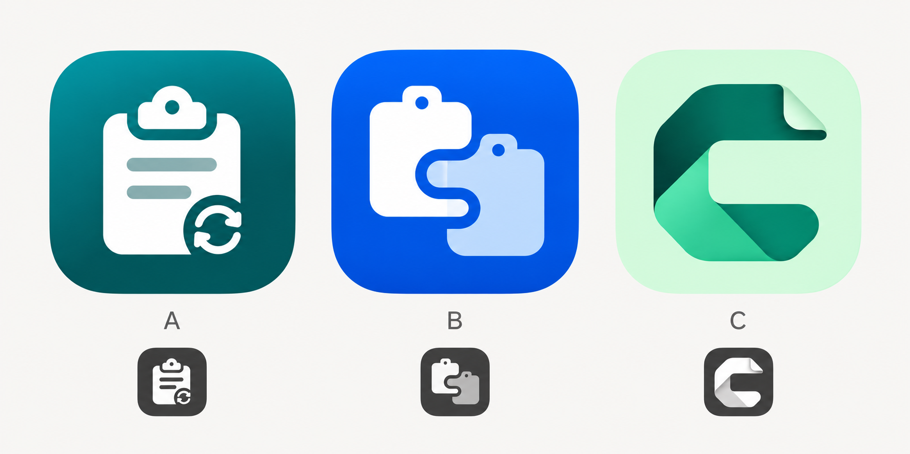

# ClipSync 아이콘 시안

클립보드 기록을 관리하면서 Mac과 Windows 사이에서 동기화한다는 제품 취지를 기준으로 한 세 가지 비교 시안입니다. 보라색은 사용하지 않았습니다.

| 시안 | 디자인 | 전달하는 기능 | 판단 |
| --- | --- | --- | --- |
| A · 클립보드 루프 | 청록 바탕의 클립보드에 작은 순환 표시 | 클립보드 관리 + 동기화 | 기능을 바로 알아보기 쉬워 추천 |
| B · 이어진 클립보드 | 파란 바탕의 두 클립보드를 S 형태로 연결 | 동등한 여러 기기가 같은 클립보드를 공유 | 기기 간 연결을 더 강조 |
| C · 접힌 C | 민트 바탕에 접힌 종이 형태의 C 심볼 | ClipSync 브랜드 + 문서·기록 | 간결하고 개성 있지만 기능을 직접 설명하는 정도는 낮음 |

## 선택한 최종 방향 · 0.4.5

사용자가 A를 선택하고 바탕은 투명하게, 안쪽 클립보드와 동기화 표시는 청록색으로 요청했습니다. 앱 로고와 Windows ICO, macOS ICNS에 같은 투명 배경 심볼을 적용했습니다. 내용 줄·클립 홀·동기화 표시 주변도 투명하므로 다크·라이트 테마의 실제 배경이 보입니다.

Mac 메뉴바는 전용 단색 템플릿 PNG의 18px/36px 두 해상도를 사용합니다. Electron `setTemplateImage(true)`를 통해 macOS가 메뉴바 배경에 맞는 흰색·검은색으로 표시합니다. 앱 테마와 메뉴바 배경이 다른 경우에도 운영체제가 적절한 색을 선택합니다. Windows 트레이에는 투명 배경 청록색 심볼을 사용합니다.

원본 PNG와 변환 결과는 저장소에 포함되어 일반 빌드에 이미지 도구가 필요하지 않습니다. 아트워크를 교체할 때는 ImageMagick 7이 있는 환경에서 `node scripts/prepare-icons.mjs`로 ICO·ICNS·트레이 해상도를 다시 만듭니다. 이 스크립트는 크기·컨테이너만 변환합니다.

위 비교 보드의 작은 미리보기는 시안 비교용이며 실제 16px 아이콘 품질 검증을 대신하지 않습니다. 최종 아이콘은 Electron의 다크·라이트 테마에서 확인합니다. 실제 Mac 메뉴바의 흰색 표시는 사용자 기기에서 추가 확인할 수 있습니다.
